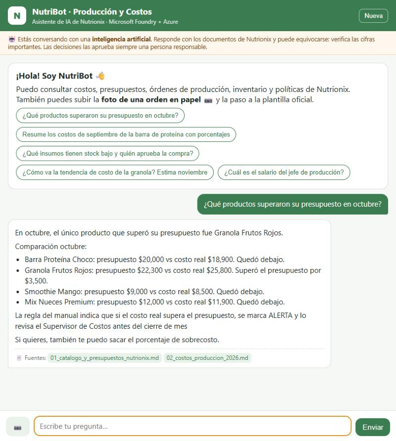
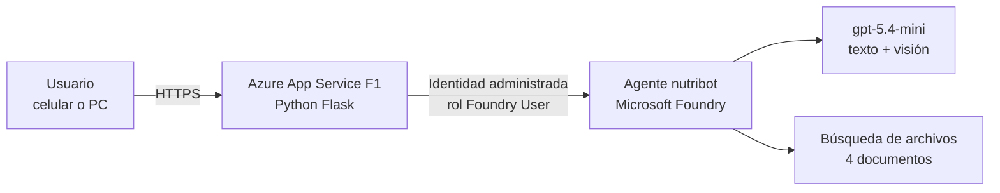

# NutriBot · Asistente de IA de Producción y Costos para Nutrionix

Proyecto integrador **Fase 2** del curso *Fundamentos de IA con Tecnologías Microsoft (AI-901)*.
Opción B: implementación con **Microsoft Foundry** del plan de IA presentado en la Fase 1.

**Autora:** María Lorenia Orantes Ramírez

| | |
|---|---|
| 🌐 **Aplicación publicada** | <https://nutribot-lorenia.azurewebsites.net> |
| 📄 **Documento del proyecto** | [docs/Nutrionix_Fase2_Entrega.md](docs/Nutrionix_Fase2_Entrega.md) |
| 🤖 **Agente** | `nutribot` en Microsoft Foundry (gpt-5.4-mini + búsqueda de archivos) |

## ¿Qué hace?

NutriBot permite a cualquier colaborador de Nutrionix, desde la computadora o el celular y sin iniciar sesión:

- Consultar **costos, presupuestos, órdenes de producción, inventario y políticas**, con la **fuente** de cada dato.
- Detectar **alertas**: sobrecostos e insumos con stock bajo.
- Subir la **foto de una orden en papel** 📷 y convertirla a la plantilla oficial, marcando con ⚠️ REVISAR lo que no se lee.
- Saber **quién aprueba** cada decisión: la IA sugiere y una persona decide.

## Arquitectura

El navegador nunca habla directo con Foundry, y la app no guarda llaves ni contraseñas: se autentica con **Microsoft Entra ID** mediante su identidad administrada.

## Estructura del repositorio

| Carpeta | Contenido |
|---|---|
| `app/` | Aplicación web (Flask): `app.py`, interfaz `templates/index.html`, `requirements.txt` y script de despliegue `desplegar.sh` |
| `agente/` | Instrucciones del agente y `setup_agent.py`, que crea el conocimiento y el agente en Foundry |
| `conocimiento/` | Los 4 documentos de Nutrionix que consulta el agente (datos de ejemplo) |
| `docs/` | Documento de entrega con capturas y guía paso a paso |

## Servicios de Azure utilizados

Microsoft Foundry (proyecto, modelo, agente, búsqueda de archivos y límites de protección) · Azure App Service · Microsoft Entra ID (identidad administrada).

> Los datos de Nutrionix de este repositorio son de ejemplo y se crearon para el prototipo.
