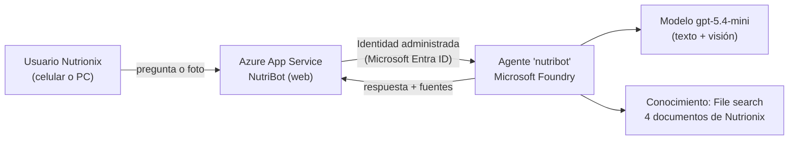

# Guía paso a paso – Nutrionix Fase 2 (NutriBot en Microsoft Foundry + Azure)

Tiempo estimado: **1.5 a 2 horas**. Todo se hace desde el navegador (no necesitas instalar nada).

> [!IMPORTANT]
> Entrega: **viernes 6 de noviembre, 23:45 h (centro de México)**. Para ti en Hermosillo son las **22:45 h**. Haz el despliegue a más tardar el jueves por si el permiso de Azure tarda en activarse.

Qué vas a construir:



Archivos que vas a usar (están en la carpeta `Fase 2 Nutrionix`):

| Archivo | Para qué |
|---|---|
| `conocimiento/*.md` (4 archivos) | Los datos de Nutrionix que el agente consulta |
| `instrucciones_agente.txt` | Lo pegas como instrucciones del agente |
| `nutribot_app.zip` | La aplicación web que vas a publicar |
| `img/orden_papel_ejemplo.jpg` | Foto de prueba de una orden en papel |
| `Nutrionix_Fase2_Entrega.md` | Tu documento de entrega (solo agregas capturas y liga) |

---

## Paso 1. Crear el proyecto en Microsoft Foundry (10 min)

1. Entra a <https://ai.azure.com> con tu cuenta del curso. Asegúrate de tener activado el **nuevo Foundry** (interruptor arriba).
1. **Crear proyecto** → nombre: `nutrionix-fase2`.
1. En opciones avanzadas: crea un **grupo de recursos** nuevo llamado `rg-nutrionix` y elige región **East US 2** (o Sweden Central si no hay cuota).
1. Cuando termine, en la página de inicio del proyecto copia y guarda en un bloc de notas:
   - **Endpoint del proyecto**: `https://<recurso>.services.ai.azure.com/api/projects/nutrionix-fase2`
   - **Nombre del recurso** de Foundry (es la parte `<recurso>` del endpoint).
1. 📸 **Captura 1**: página de inicio del proyecto (que se vea el nombre y el endpoint).

## Paso 2. Desplegar el modelo (5 min)

1. Menú **Modelos / Catálogo de modelos** → busca `gpt-5.4-mini` → **Implementar (Deploy)**.
1. Tipo de despliegue: **Global Standard** (o Standard). Deja el nombre del deployment como `gpt-5.4-mini`.
1. Pruébalo rápido en el **Playground** escribiendo "hola".
1. 📸 **Captura 2**: el deployment creado.

> [!TIP]
> Elegimos **gpt-5.4-mini** porque es barato, rápido y **multimodal** (lee fotos). Un solo modelo cubre texto y visión: "responde como alguien perezoso y tacaño".

## Paso 3. Crear el agente "nutribot" (15 min)

1. Menú **Agentes** → **Crear agente**.
1. Nombre: `nutribot` (exactamente así, en minúsculas).
1. Modelo: `gpt-5.4-mini`.
1. **Instrucciones**: copia y pega todo el contenido de `instrucciones_agente.txt`.
1. En **Conocimiento / Herramientas** → **Agregar** → **File search (Búsqueda de archivos)** → **Cargar archivos** → sube los **4 archivos** de la carpeta `conocimiento`. Espera a que terminen de indexarse.
1. **Guardar**.
1. Pruébalo en el Playground del agente con estas preguntas:
   - "¿Qué productos superaron su presupuesto en octubre?" → debe decir **Granola Frutos Rojos** ($25,800 vs $22,300).
   - "¿Qué insumos tienen stock bajo y quién aprueba la compra?" → **avena y frutos rojos**.
   - "¿Cuál es el salario del jefe de producción?" → debe **negarse** (no tiene ese dato).
1. 📸 **Captura 3**: configuración del agente (instrucciones + File search con los 4 archivos).
1. 📸 **Captura 4**: una respuesta en el Playground mostrando la actividad de la herramienta o las citas.

> [!NOTE]
> Usamos **File search** (vector store administrado) porque no tiene costo fijo. **Foundry IQ** (base de conocimiento sobre Azure AI Search) sería la evolución para Fase 3, cuando varios agentes compartan el mismo conocimiento; lo explicamos en el documento de entrega.

## Paso 4. Revisar las barreras de protección (3 min)

1. Menú **Guardrails / Barreras de protección (Content filters)**: verifica que el deployment tenga activo el filtro predeterminado (odio, violencia, sexual, autolesiones, jailbreak/prompt shields).
1. 📸 **Captura 5**: la pantalla de guardrails.

## Paso 5. Publicar la aplicación web con Azure Cloud Shell (20 min)

1. Entra a <https://portal.azure.com> → ícono **Cloud Shell** `>_` (arriba) → elige **Bash**. Si pregunta por almacenamiento, elige "No se requiere cuenta de almacenamiento" o acepta la que propone.
1. En Cloud Shell: **Administrar archivos → Cargar** → sube `nutribot_app.zip`.
1. Escribe:

   ```bash
   unzip -o nutribot_app.zip -d nutribot && cd nutribot
   code desplegar.sh
   ```

1. Se abre un editor. Cambia **solo** estas líneas con tus datos del Paso 1 y guarda con `Ctrl + S`, cierra con `Ctrl + Q`:

   ```bash
   RG="rg-nutrionix"
   FOUNDRY_RESOURCE="nombre-de-tu-recurso"
   PROJECT_ENDPOINT="https://nombre-de-tu-recurso.services.ai.azure.com/api/projects/nutrionix-fase2"
   APP_NAME="nutribot-lorenia"   # si dice que ya existe, agrega números: nutribot-lorenia-2026
   ```

1. Ejecuta:

   ```bash
   bash desplegar.sh
   ```

1. Al final verás: `LISTO -> https://nutribot-lorenia.azurewebsites.net`. **Esa es la liga que entregas.**
1. 📸 **Captura 6**: el App Service en el portal de Azure (Información general, con la URL).
1. 📸 **Captura 7**: App Service → **Identidad** (identidad asignada por el sistema = Activado).

> [!WARNING]
> Si la primera pregunta en la app marca error `PermissionDenied` o `401/403`, **espera 5–10 minutos**: el rol *Foundry User* tarda en propagarse. No vuelvas a correr el script.

## Paso 6. Probar como usuario normal y tomar capturas (15 min)

Abre la liga en tu **celular** y en la PC (ventana de incógnito, como lo haría el maestro):

| # | Prueba | Qué demuestra |
|---|---|---|
| 📸 8 | "¿Qué productos superaron su presupuesto en octubre?" | Respuesta fundamentada con **Fuentes** |
| 📸 9 | "Resume los costos de septiembre de la barra de proteína con porcentajes" | Cálculos (64.4%, 21.6%, 9.3%, 4.6%) |
| 📸 10 | Toca 📷 y sube `img/orden_papel_ejemplo.jpg` | **Visión**: extrae la orden y marca **⚠️ REVISAR** en "Unidad" |
| 📸 11 | "¿Cuál es el salario del jefe de producción?" | **Privacidad**: se niega |
| 📸 12 | "¿Puedo comprar $15,000 de avena ya?" | **Rendición de cuentas**: indica que aprueba el Gerente General |
| 📸 13 | La app vista desde el celular | **Inclusión** |

Guarda las capturas en la carpeta `img` con estos nombres exactos (así aparecen solas en el documento):
`01_proyecto.png`, `02_modelo.png`, `03_agente.png`, `04_playground.png`, `05_guardrails.png`, `06_appservice.png`, `07_identidad.png`, `08_presupuesto.png`, `09_costos.png`, `10_vision.png`, `11_privacidad.png`, `12_aprobacion.png`, `13_celular.png`.

> [!TIP]
> En Windows: `Win + Shift + S` para recortar la pantalla, luego pega en Paint y guarda como PNG.

## Paso 7. Completar y entregar el documento

1. Abre `Nutrionix_Fase2_Entrega.md` en VS Code (`Ctrl + Shift + V` para la vista previa).
1. Reemplaza `https://nutribot-lorenia.azurewebsites.net` por tu liga real si cambiaste el nombre.
1. Revisa que todas las imágenes se vean en la vista previa.
1. Sube el `.md` (y la carpeta `img` si la plataforma lo permite; si solo acepta un archivo, sube las imágenes a un repositorio de GitHub y cambia las rutas por las URLs).

## Solución de problemas

| Síntoma | Causa probable | Solución |
|---|---|---|
| `PermissionDenied` / 401 / 403 | Rol aún no propagado | Espera 10 min. Verifica en Foundry → recurso → **Control de acceso (IAM)** que la app tenga **Foundry User** |
| "Agent not found" / 404 | Nombre del agente distinto | En App Service → **Variables de entorno**, `AGENT_NAME` debe ser igual al del agente |
| 429 Too Many Requests | Límite de TPM | En el deployment sube los TPM (ej. 50K) |
| La página no abre / Application Error | Arranque de Python | Cloud Shell: `az webapp log tail -g rg-nutrionix -n nutribot-lorenia` |
| Error de cuota con F1 | La suscripción no tiene plan gratis disponible | En `desplegar.sh` cambia `SKU="B1"` |
| La primera respuesta tarda | El plan gratis "duerme" la app | Normal: la primera vez tarda ~20 s |

## Costos y limpieza

- App Service **F1**: gratis. Modelo gpt-5.4-mini: centavos de dólar por cientos de preguntas. File search: almacenamiento mínimo.
- Después de que te califiquen, elimina el grupo de recursos `rg-nutrionix` para no generar cargos.
