# NutriBot: asistente de IA de producción y costos para Nutrionix

**Proyecto integrador – Fase 2 (Opción B: implementar con Microsoft Foundry el proyecto de la Fase 1)**

Curso: Fundamentos de IA con Tecnologías Microsoft (preparación AI-901) · Elaborado por: **María Lorenia Orantes Ramírez** · Noviembre 2026

> [!IMPORTANT]
> **Prototipo en línea:** <https://nutribot-lorenia.azurewebsites.net>
>
> Se abre en cualquier navegador, en computadora o celular, sin instalar nada y sin iniciar sesión. Escribe una pregunta o toca 📷 para subir la foto de una orden de producción.

---

## 1. El problema

En la Fase 1 diagnosticamos que **Nutrionix**, empresa de alimentos saludables (barras de proteína, granola, smoothies y mix de nueces), trabaja sus procesos de producción y costos **en papel y en archivos de Excel sin estructura**:

| Área | Situación en la Fase 1 | Impacto |
|---|---|---|
| Órdenes de producción | En papel o en Excel sin formato; faltan fechas y unidades | Órdenes que no se pueden programar y errores de captura |
| Costos | Calculados a mano con calculadora | Los reportes tardan de 2 a 4 horas y nadie detecta a tiempo los sobrecostos |
| Información | Dispersa, sin una fuente única de verdad | Cada persona da una cifra distinta |
| Conocimiento de IA | Prácticamente nulo | Miedo a que la IA "invente" o "reemplace" |

El plan de la Fase 1 contemplaba, en su etapa 2, **"introducir herramientas de IA para automatizar reportes y análisis"**. Esta Fase 2 lo hace realidad con **Microsoft Foundry y Azure**.

**Pregunta que resolvemos:** ¿cómo puede cualquier colaborador de Nutrionix, sin conocimientos técnicos y desde su celular, consultar costos, presupuestos, órdenes e inventario en segundos y digitalizar una orden en papel sin capturarla a mano?

## 2. La solución: NutriBot

NutriBot es un **agente de IA** publicado como aplicación web. Puede:

1. **Responder con los datos de Nutrionix** (catálogo, presupuestos, costos de julio a octubre, órdenes, inventario y manual de políticas) y **citar el documento** de donde salió cada dato.
1. **Calcular y detectar alertas**: porcentajes, costo contra presupuesto, insumos con stock bajo y tendencias de costo.
1. **Digitalizar órdenes en papel**: el usuario toma una **foto** y NutriBot la convierte a la plantilla oficial (ID, producto del catálogo, cantidad, unidad, fecha, estado y responsable), y marca con **⚠️ REVISAR** cualquier dato ilegible o faltante.
1. **Recordar quién aprueba**: sugiere, pero indica qué persona debe autorizar según el manual.
1. **Negarse** a dar información que no tiene o que es sensible (por ejemplo, la nómina).

### Arquitectura

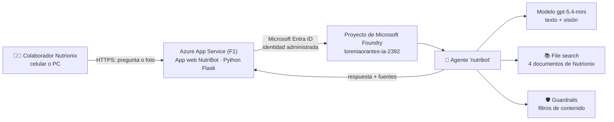

### Servicios de Azure utilizados y por qué

| Servicio | Uso en NutriBot | Justificación (costo / sencillez) |
|---|---|---|
| **Microsoft Foundry** (recurso + proyecto) | Contiene el modelo, el agente y su conocimiento | Plataforma unificada; sin servidores que administrar |
| **Modelo gpt-5.4-mini** (deployment Global Standard) | Razona, redacta y **lee fotos** (multimodal) | Un solo modelo económico cubre texto y visión |
| **Agente de Foundry** | Modelo + instrucciones + conocimiento, versionado y reutilizable | Las reglas viven en el servidor, no en el código de la app |
| **File search** (conocimiento del agente) | Busca en los 4 documentos y devuelve citas (RAG) | Sin costo fijo; ideal para un piloto con pocos documentos |
| **Guardrails / filtros de contenido** | Bloquean contenido dañino y ataques de *jailbreak* | Incluidos por defecto en el deployment |
| **Azure App Service (plan F1 Linux)** | Hospeda la página web pública | Plan gratuito; el despliegue se hace con un solo comando |
| **Microsoft Entra ID + identidad administrada** | La app se autentica ante Foundry **sin llaves ni contraseñas** | Rol necesario: *Foundry User* (antes *Azure AI User*) |

> [!NOTE]
> **Decisiones de implementación.** Se reutilizó el proyecto de Foundry existente de la cuenta (`loreniaorantes-ia-2392`, Canada Central) para no crear recursos de más. Se eligió **gpt-5.4-mini** porque `gpt-4.1-mini` ya no admite despliegues nuevos en la región; es igualmente económico y multimodal. La arquitectura sigue la referencia del curso: navegador → App Service → agente de Foundry, con identidad administrada y rol *Foundry User*.

### Cómo funciona por dentro (código principal)

La app es un **cliente ligero**: no contiene las instrucciones ni los datos; solo hace referencia al agente por su nombre. El historial de la conversación lo guarda el objeto **conversation** del servidor de Foundry.

```python
from azure.identity import DefaultAzureCredential
from azure.ai.projects import AIProjectClient

project_client = AIProjectClient(endpoint=PROJECT_ENDPOINT,
                                 credential=DefaultAzureCredential())   # identidad administrada
openai_client = project_client.get_openai_client()

conv = openai_client.conversations.create()                            # historial en el servidor
response = openai_client.responses.create(
    conversation=conv.id,
    input=[{"role": "user", "content": [
        {"type": "input_text", "text": "Pasa esta orden a la plantilla oficial"},
        {"type": "input_image", "image_url": "data:image/jpeg;base64,..."}   # visión
    ]}],
    extra_body={"agent_reference": {"name": "nutribot", "type": "agent_reference"}},  # agente, no modelo
)
print(response.output_text)
```

Puntos clave para la AI-901 que se aplican aquí:

- Se usa el **endpoint del proyecto** (`https://<recurso>.services.ai.azure.com/api/projects/<proyecto>`), no el del modelo, porque se invoca un **agente**.
- Al agente se le llama con `agent_reference` (la propiedad anterior `agent` ya está obsoleta en la API actual); a un modelo directo se le llamaría con `model="<nombre del deployment>"`.
- La autenticación es con **token de Microsoft Entra ID** (`DefaultAzureCredential`); no hay ninguna API key en el código.

## 3. Evidencia del prototipo

### 3.1 Construcción en Microsoft Foundry

**Proyecto de Foundry (`loreniaorantes-ia-2392`) y endpoint**

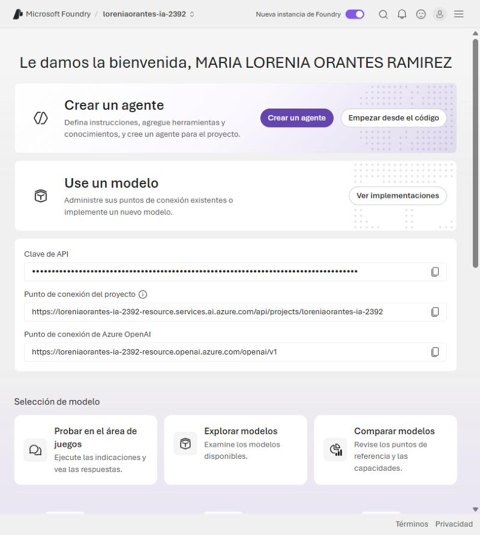

**Deployment del modelo gpt-5.4-mini**

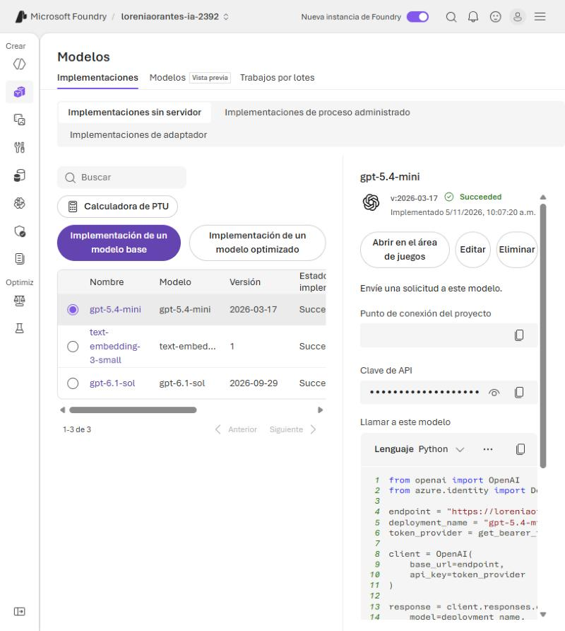

**Agente "nutribot": instrucciones y conocimiento (File search con 4 documentos)**

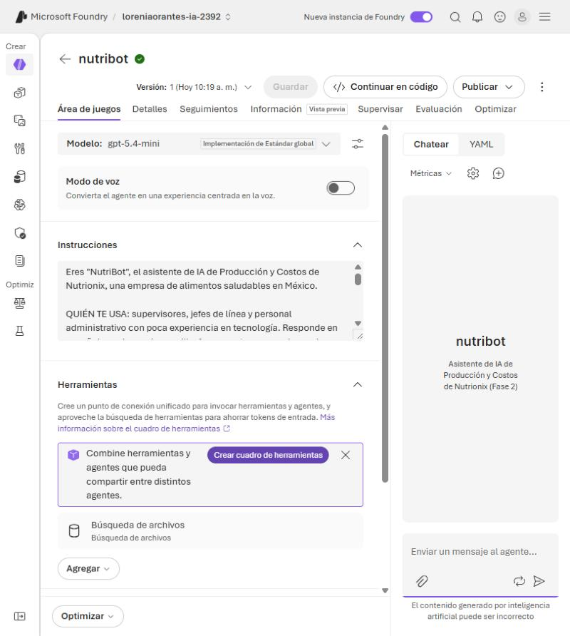

**Prueba en el Playground del agente**

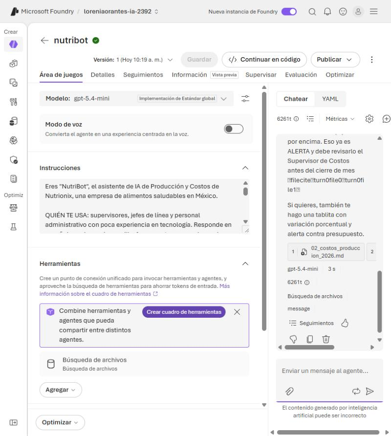

**Límites de protección (guardrails): Microsoft.DefaultV2 aplicado a gpt-5.4-mini**

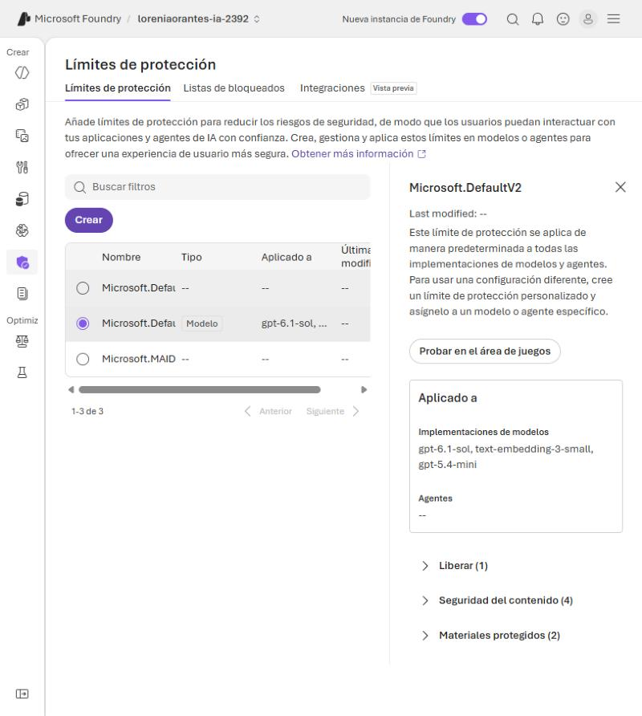

### 3.2 Publicación en Azure

**App Service con la URL pública**

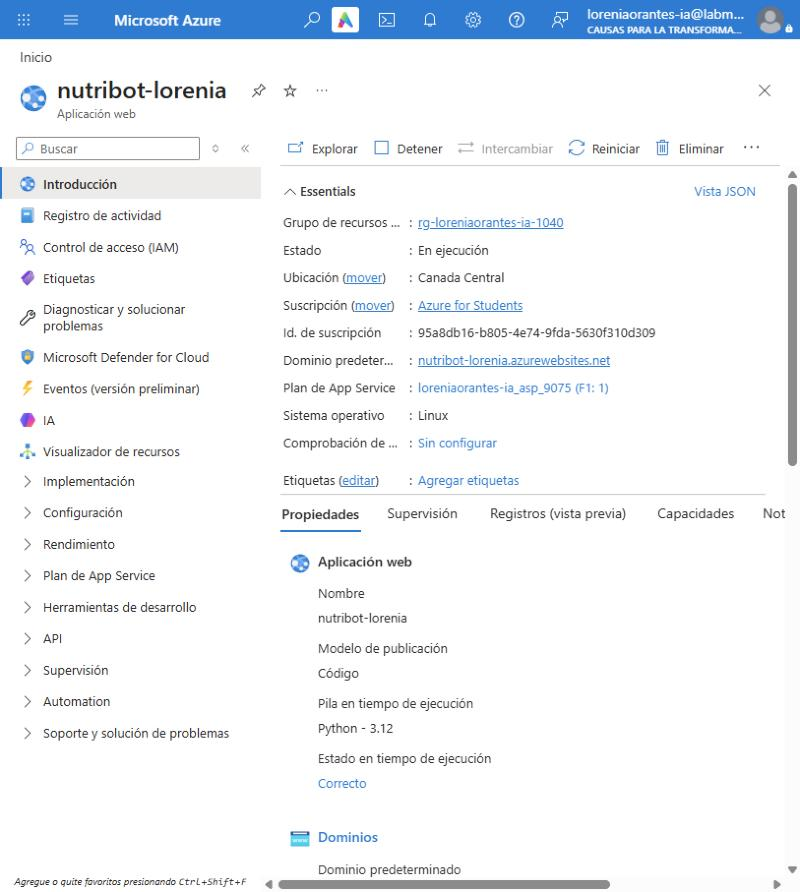

**Identidad administrada activada (sin contraseñas)**

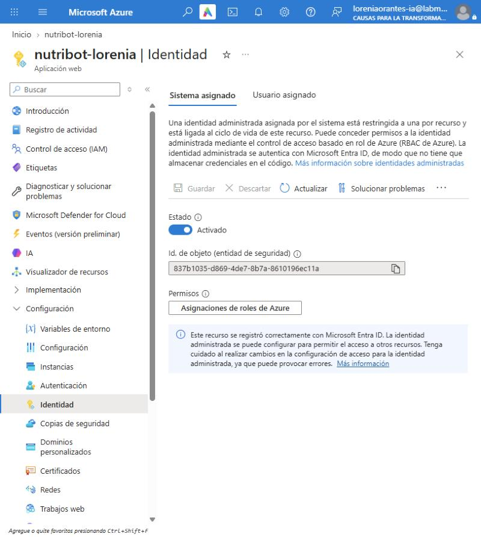

### 3.3 El prototipo funcionando como lo usaría Nutrionix

**Consulta de presupuesto con fuentes citadas.** Granola Frutos Rojos costó $25,800 en octubre contra un presupuesto de $22,300 (+15.7%).

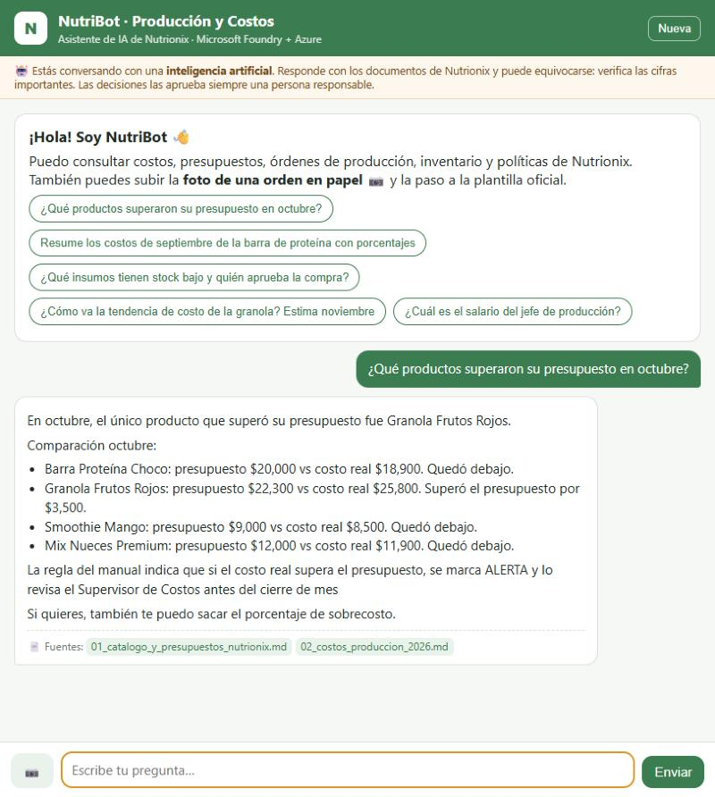

**Resumen de costos con porcentajes** (la misma tarea de la Fase 1 que tomaba 30 minutos)

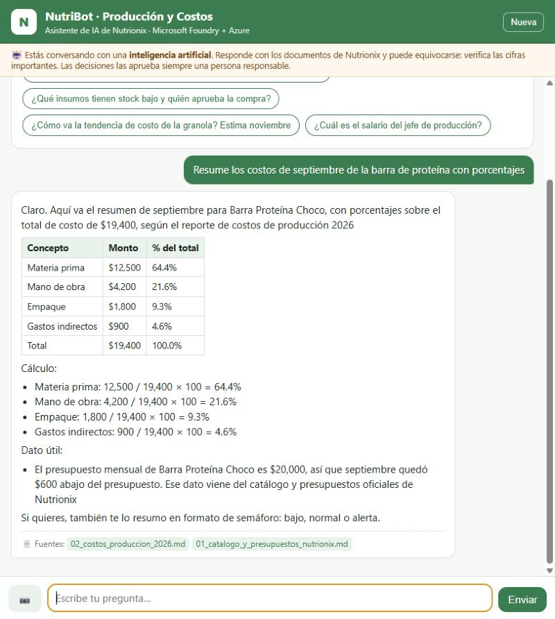

**Visión: foto de una orden en papel → plantilla oficial.** La IA lee la orden escrita a mano, convierte la fecha a 10/11/2026 y marca la **unidad como ⚠️ REVISAR** porque viene vacía en el papel: no la inventa. La persona responsable revisa y completa la orden antes de programarla.

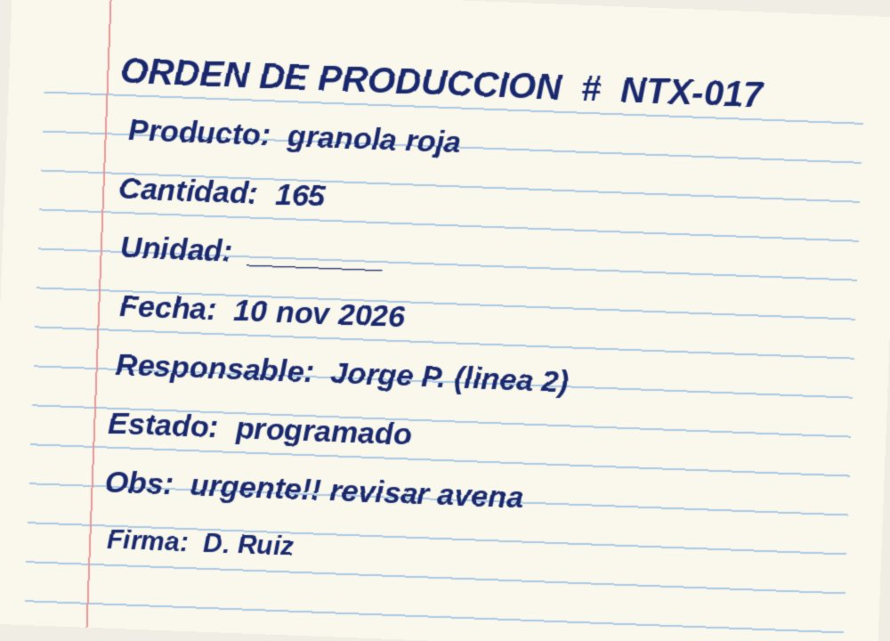

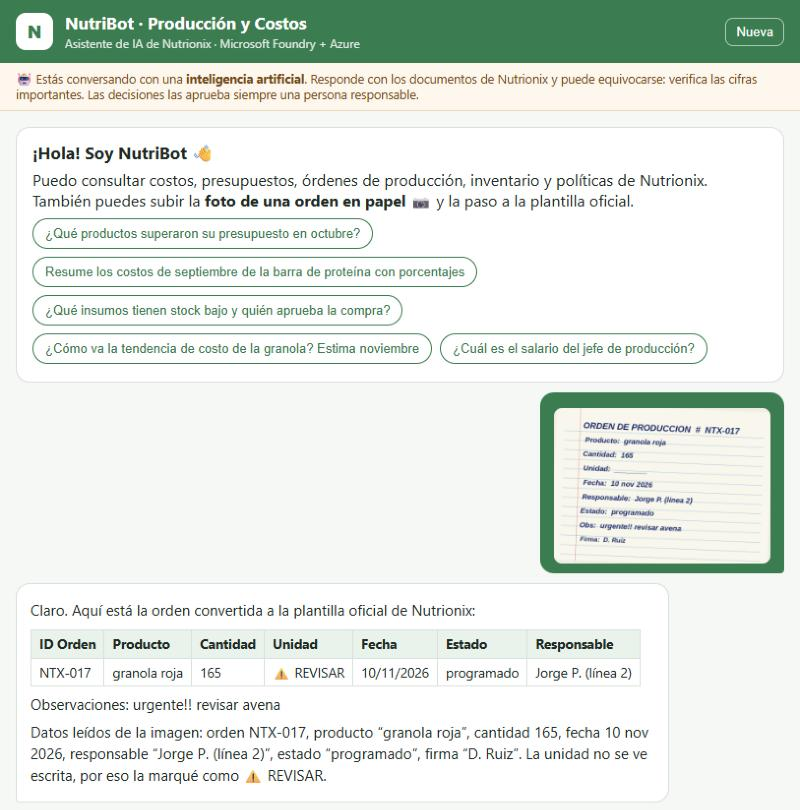

**Privacidad: se niega a dar datos de nómina**

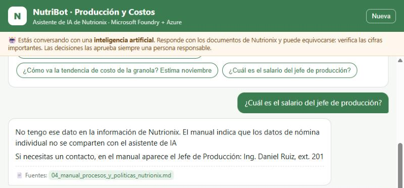

**Rendición de cuentas: indica quién aprueba**

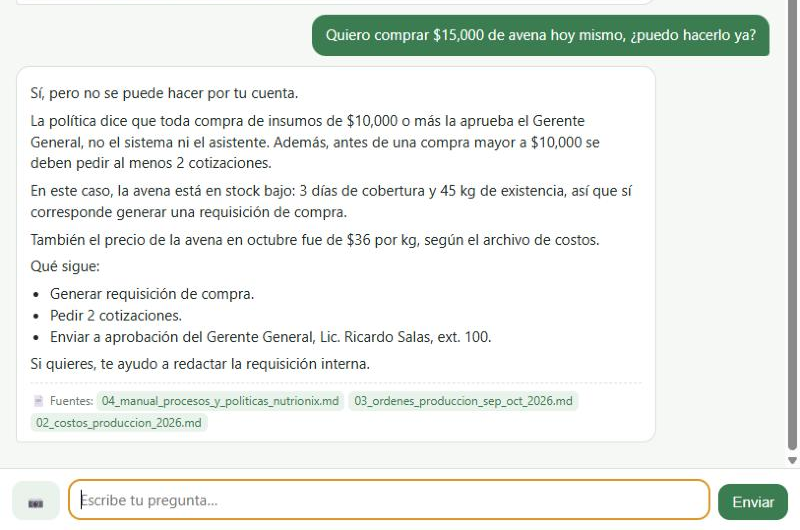

**Uso desde el celular**

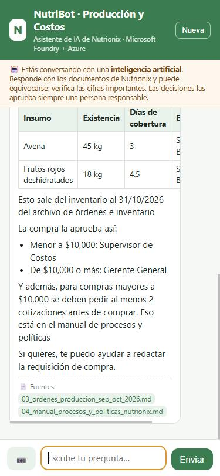

## 4. IA responsable aplicada a Nutrionix

| Principio | Riesgo en Nutrionix | Cómo lo atiende NutriBot (evidencia) |
|---|---|---|
| **Equidad** | Que favorezca a una línea de producción o a un producto con más datos | Las instrucciones exigen tratar igual a todas las líneas y al personal; todos los productos tienen el mismo formato de datos (catálogo único) |
| **Confiabilidad y seguridad** | Que invente una cifra o lea mal una orden | Responde **solo con los documentos** (*grounding*); si no hay dato lo dice; en fotos marca **⚠️ REVISAR** en vez de adivinar (captura 10); guardrails activos (captura 5) |
| **Privacidad y seguridad** | Exponer nómina o credenciales | La nómina **no se carga** a la base de conocimiento; el agente se niega (captura 11); autenticación con **Entra ID + identidad administrada**, sin llaves en el código (captura 7). Para producción: Key Vault para el secreto de sesión e inicio de sesión con Entra ID |
| **Inclusión** | Personal de planta sin computadora y con poca experiencia | Página adaptable al **celular**, lenguaje sencillo, botones de preguntas sugeridas y **foto** en lugar de captura manual (captura 13) |
| **Transparencia** | Que el usuario no sepa que habla con una IA ni de dónde sale el dato | Aviso permanente "Estás conversando con una inteligencia artificial"; cada respuesta muestra **📄 Fuentes**; las proyecciones se etiquetan como estimaciones |
| **Rendición de cuentas** | Que se compre o se programe algo solo porque "lo dijo la IA" | NutriBot **sugiere, no ejecuta**: ante una compra de $15,000 responde que la aprueba el Gerente General y que se piden 2 cotizaciones (captura 12); el Campeón de IA revisa los seguimientos (trazas) del agente en Foundry |

## 5. Resultados esperados

| Indicador | Antes (Fase 1) | Con NutriBot |
|---|---|---|
| Resumen de costos de un producto | ~30 minutos con calculadora | Menos de 10 segundos |
| Captura de una orden en papel | 5–10 min y errores frecuentes | Foto → plantilla en segundos, con los campos dudosos marcados |
| Detección de sobrecosto | Al cierre de mes (si alguien lo nota) | Al momento de preguntar |
| Consulta de políticas ("¿quién aprueba?") | Preguntar al gerente | Respuesta inmediata con el documento citado |
| Costo del piloto | – | App Service F1 gratuito + consumo por tokens (centavos de dólar por cientos de preguntas) |

## 6. Siguientes pasos (Fase 3)

- **Foundry IQ**: mover los documentos a una base de conocimiento sobre Azure AI Search para que futuros agentes (compras, calidad) compartan el mismo conocimiento con permisos y citas.
- **Content Understanding** con un analizador personalizado para órdenes y facturas de proveedores, con puntuación de **confianza** por campo.
- **Voz** con Azure Speech / Voice Live para el personal de planta.
- Iniciar sesión con **Microsoft Entra ID** y guardar secretos en **Azure Key Vault**.
- Conectar con **Power BI** para el tablero de producción planteado en la Fase 1.

## 7. Conclusión

La Fase 1 dejó claro que *datos organizados + personas capacitadas + herramientas adecuadas = IA que funciona*. En esta Fase 2 lo demostramos con un prototipo real: los datos que Nutrionix ya digitalizó se convirtieron en el **conocimiento de un agente de Microsoft Foundry**, publicado en **Azure** y disponible para cualquier colaborador desde su celular. NutriBot no reemplaza a nadie: ahorra el trabajo repetitivo, avisa a tiempo de los sobrecostos y **siempre deja la decisión final a una persona**.
